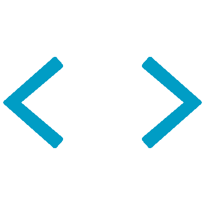

<h1 align="center"><b>Hi , I'm Matin </b></h1>
<!--  -->

 

	
##  **About me**

 

AI Engineer with an M.Sc. in Artificial Intelligence and a Computer Science background. I work across applied AI, computer vision, LLMs, RAG, and backend engineering, building practical AI-powered applications and scalable software systems.

With hands-on experience in Python, JavaScript, and Node.js, I'm interested in turning AI research and modern machine learning techniques into reliable, real-world solutions.

Currently exploring applied LLM systems, intelligent agents, and AI-driven software development.

  

## <b> Skills</b>
 

- **💻 Languages I have used**:

    
    
    
    

    
- Artificial intelligence:
   
  Machine Learning | Deep Learning | Computer Vision | Artificial Neural Networks | Data Mining | Python | MATLAB 

- Backend Programming:
   
  Node.js | JavaScript | Express.js | Databases (SQL & NoSQL)

- Others:
   
  Unity | c# | C++ | Linux | Cyber Security 

 

## <b> Let's Connect..!</b>

<ul>

 

</ul>

 
 
 
